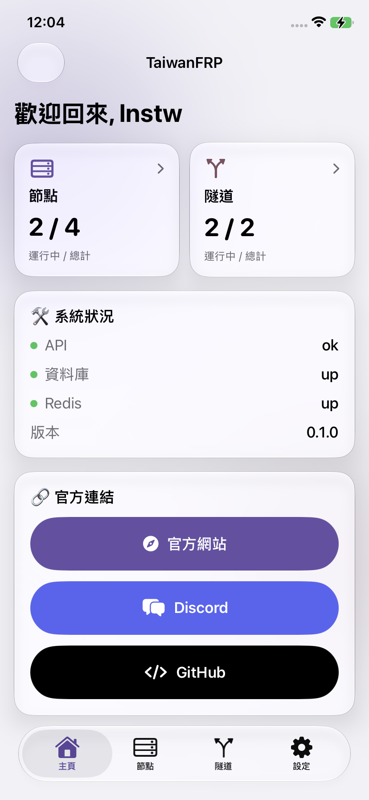
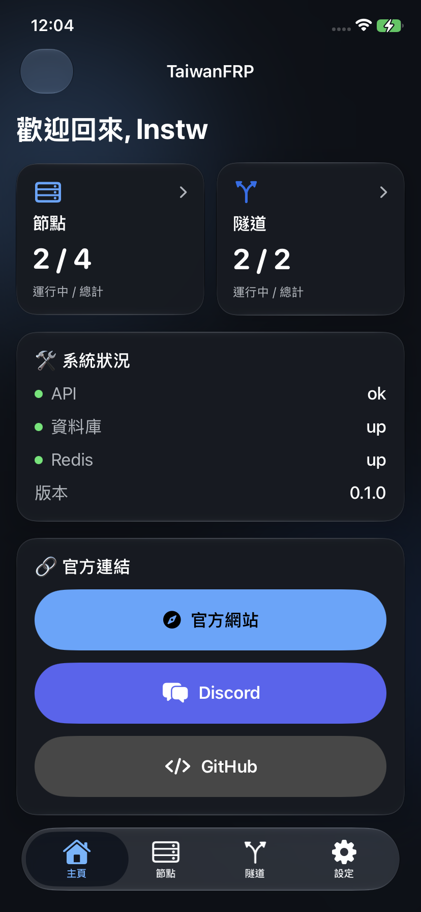
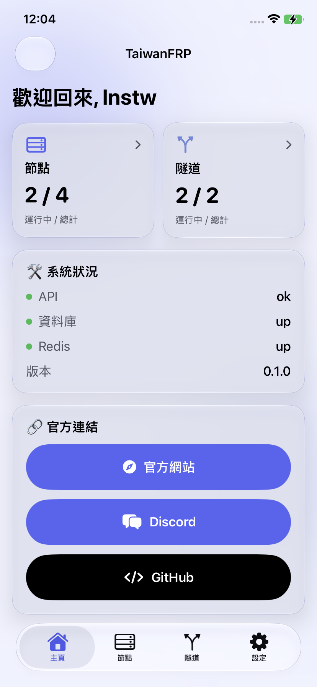
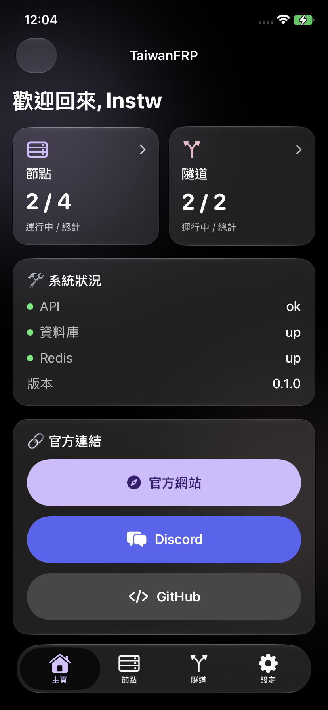
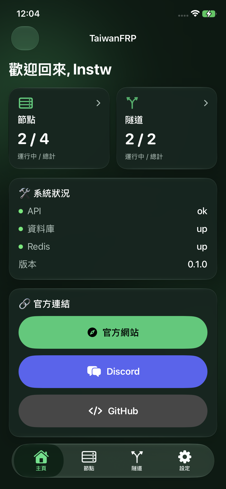
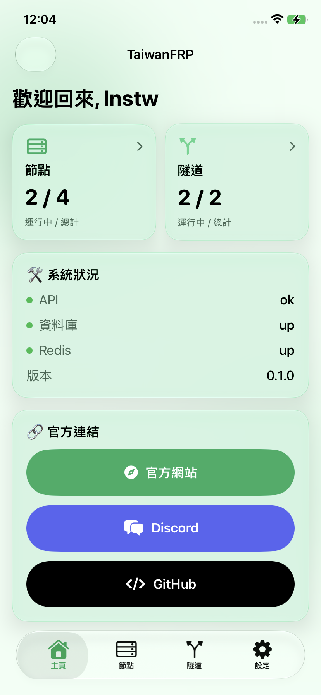
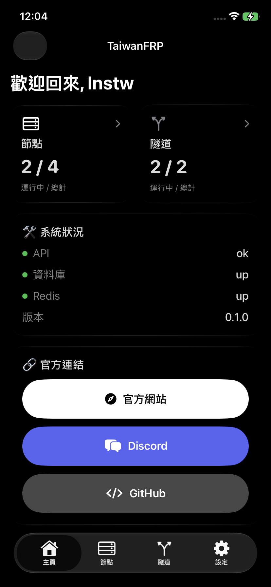
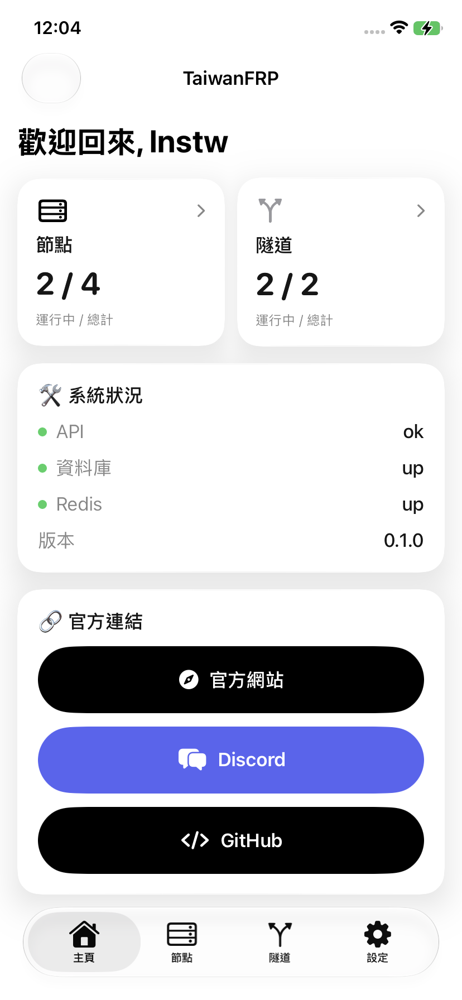

# TaiwanFRP iOS App

TaiwanFRP iOS 版是為 [TaiwanFRP](https://taiwanfrp.me) 免費內網穿透服務打造的原生 iPhone / iPad 應用程式。
功能與 [Android 版](https://github.com/TaiwanFRP/android-app) 相同，介面則改用 SwiftUI 與 iOS 26 的 Liquid Glass 設計重新打造，
讓你在 iPhone 上也能隨時管理節點與隧道、掌握系統狀態。

# 使用此 App 時建議 Discord 帳戶開啟 2FA 驗證

因為驗證機器人過不去 :D

## 🚀 功能特色

### 📊 儀表板與狀態監控

- **即時系統狀態**：以狀態燈號顯示 API、資料庫與 Redis 的運行狀況。
- **統計數據**：一眼看出節點與隧道的運行中 / 總計數量，點擊卡片直接前往對應頁面。
- **官方連結**：一鍵開啟官網、Discord 群組與 GitHub 專案。

### 🛠️ 隧道管理 (Tunnel Management)

- **靈活配置**：支援 TCP、UDP 通訊協定。
- **進階功能**：可選開啟 KCP 加速與 Proxy Protocol v2。
- **自動化**：依節點開放的埠號範圍隨機選取遠端連接埠。
- **全方位管理**：建立、編輯、刪除隧道，長按卡片即可快速操作。
- **一鍵複製**：點擊 ID、本機位址、遠端埠號即可複製。

### 🌐 節點資訊 (Node Info)

- **實時列表**：查看所有節點的主機地址、連接埠範圍，以及上線 / 下線與運營狀態。
- **原生搜尋**：依名稱或主機快速篩選節點。
- **免登入查看**：訪客模式不需登入即可查看節點狀態。
- **節點提供者**：滑到清單底部繼續上拉，即可申請成為節點提供者。

### 🎨 個人化設定

- **多樣化主題**：內建 9 款主題（極致黑、湖水藍、薄荷綠等），「系統」主題會跟隨 iOS 深淺色自動切換。
- **多國語言**：支援 **繁體中文** 與 **English**，可跟隨系統語言。
- **自訂頻率**：可調整資料自動更新頻率，App 在背景時自動暫停更新。
- **更新提醒**：啟動時自動檢查 GitHub Releases 是否有新版本（iOS 無法直接安裝，會引導前往下載頁）。
- **小工具**：內建手電筒開關。

### 🔐 安全與帳號

- **Discord 整合**：使用 Discord 帳號登入，登入憑證存放於 iOS 鑰匙圈（Keychain）。
- **權限管理**：依使用者權限自動切換可用功能（例如具備權限才可建立節點，只有擁有者能編輯 / 刪除節點）。
- **帳號狀態**：帳號未啟用、被封禁或刪除時顯示對應說明與聯絡管道。
- **隱私控制**：登出時可選擇同時清除 Discord 登入狀態。

## 🎨 主題

「系統」主題會跟隨 iOS 的外觀設定，自動切換成「淺色」或「深色」。

| 基本設定 | 深色系風格 | 淺色系風格 |
|:-------:|:--------:|:--------:|
| <br>淺色 | <br>藍色 | <br>湖水藍 |
| <br>深色 | <br>綠色 | <br>薄荷綠 |
| 跟隨系統 | <br>極致黑 | <br>極致白 |

## 🛠️ 技術棧

- **UI 框架**：[SwiftUI](https://developer.apple.com/xcode/swiftui/)（Liquid Glass、Tab API）
- **程式語言**：[Swift 6](https://www.swift.org/)
- **網路請求**：URLSession + Swift Concurrency (async / await)
- **資料序列化**：Codable
- **本地儲存**：Keychain（登入憑證）、UserDefaults（偏好設定）
- **WebView**：WKWebView 整合 Discord OAuth2 登入流程
- **建置工具**：[xtool](https://github.com/xtool-org/xtool)（可在 Linux / WSL 上建置 iOS App）

## 📦 安裝需求

- **最低版本**：iOS / iPadOS 26.0

## 📥 下載與安裝

到 [Releases](https://github.com/TaiwanFRP/ios-app/releases) 下載最新的 `taiwanfrp-ios-vX.X.X-unsigned.ipa`，
再使用 [AltStore](https://altstore.io)、[SideStore](https://sidestore.io) 或 [Sideloadly](https://sideloadly.io) 等工具以自己的 Apple 帳號簽名安裝。

## 🛠️ 開發與建置

1. 複製專案：
   ```bash
   git clone https://github.com/TaiwanFRP/ios-app.git
   ```
2. 安裝並設定 [xtool](https://github.com/xtool-org/xtool)（需要 Apple 帳號與 Darwin SDK）。
3. 建置：
   ```bash
   xtool dev build
   ```
4. 連接 iPhone 後執行以下指令，即可安裝到實體裝置：
   ```bash
   xtool dev
   ```

也可以直接使用 Xcode 開啟 `Package.swift` 進行開發。

## 🤝 貢獻與反饋

如果您發現任何 Bug 或有功能建議，歡迎：

- 提交 [GitHub Issue](https://github.com/TaiwanFRP/ios-app/issues)
- 加入 [Discord 伺服器](https://discord.gg/ueGFVVHp85) 與開發者交流

## 📄 致謝

- 帳號狀態頁圖示取自 [Material Icons](https://github.com/google/material-design-icons)（Apache License 2.0），與 Android 版一致。

---
**iOS 版開發者**：[lnstw](https://github.com/lnstw)
**Android 版開發者**：臭臭卓的冰箱吉祥物
**專案連結**：[TaiwanFRP GitHub](https://github.com/TaiwanFRP)
